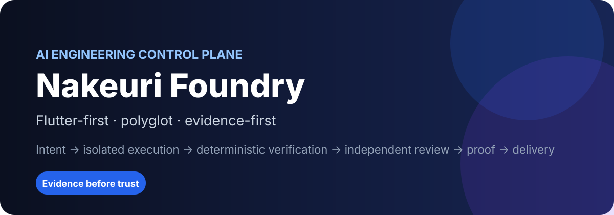
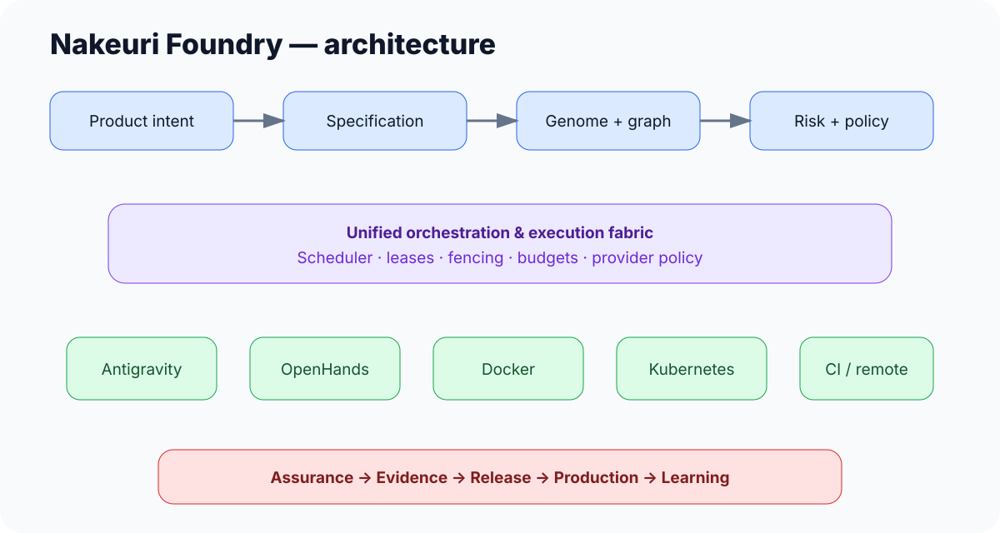
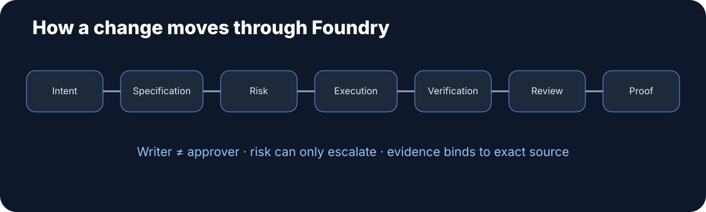
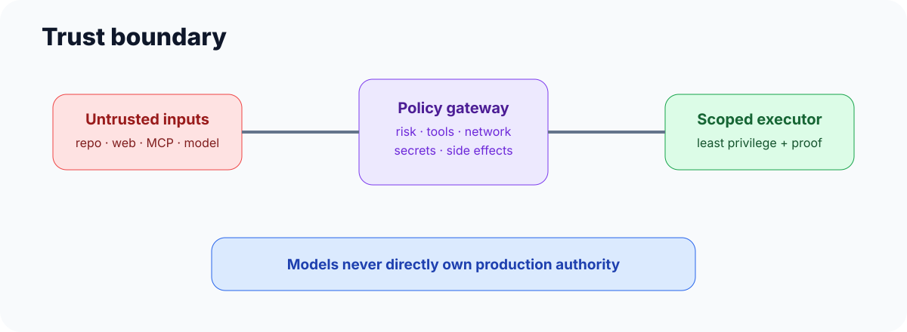
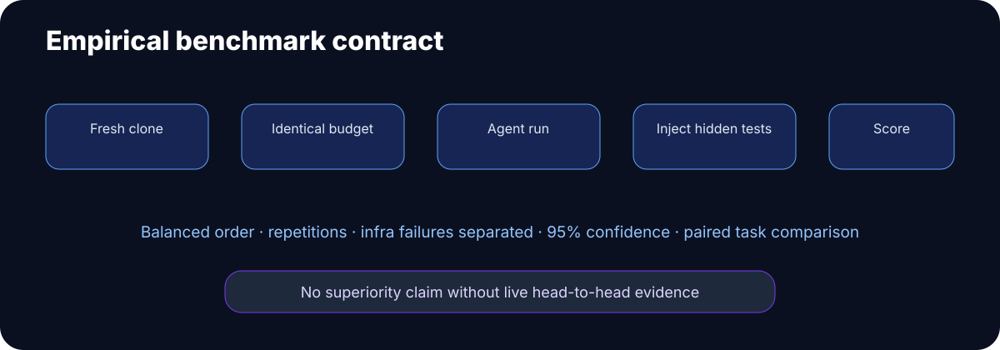

<div align="center">



<br/>

[](#validation-status)
[](LICENSE)
[](pyproject.toml)
[](#flutter-is-the-flagship-profile)
[](#evidence-before-trust)

**A Flutter-first, polyglot AI engineering control plane that turns product intent into isolated implementation, deterministic verification, independent review, evidence, and controlled delivery.**

[Quick start](#quick-start) · [Architecture](#architecture) · [How it works](#how-a-change-moves-through-foundry) · [Security](#security-and-trust-boundaries) · [Benchmarks](#empirical-benchmarking) · [Docs](#documentation-map)

</div>

---

## What is Nakeuri Foundry?

Nakeuri Foundry is an engineering **control plane around coding agents**, not another general-purpose chat agent.

Its job is to make AI-assisted development behave more like a disciplined engineering organization:

- translate goals into explicit requirements and executable acceptance oracles;
- discover project architecture, ownership, contracts and invariants before changing code;
- route work by risk, cost and evidence quality;
- isolate implementation in worktrees, containers or controlled remote runtimes;
- use native framework intelligence such as Flutter/Dart skills, Dart MCP and language servers;
- prevent the writer from approving its own work;
- require deterministic tests, runtime evidence and independent review;
- bind proof to an exact source snapshot;
- stage production changes behind policy, health and approval gates;
- convert verified failures into durable regression defenses.

The core is polyglot. **Flutter is the flagship profile**, because the system composes the official Flutter/Dart AI toolchain with project-specific engineering context rather than trying to replace it.

> **Core rule:** AI output is a proposal, not ground truth. A task is complete only when the required evidence exists for the exact source state being approved.

---

## Why this exists

Coding agents can generate large amounts of code quickly. The harder engineering problems happen around the code:

- Did the agent understand the product requirement correctly?
- Did it find the real owner of the capability instead of creating a duplicate?
- Did a mobile change silently break the API, schema or older client?
- Did a security-sensitive task accidentally take a low-risk execution path?
- Did tests actually exercise the changed behavior, or did the agent merely report that they passed?
- Can the change be rolled back?
- Can an escaped defect become a permanent defense instead of a forgotten chat message?
- Are expensive models being spent on problems deterministic tools could solve?

Nakeuri Foundry turns those questions into **machine-readable state, policy and evidence**.

---

## Design principles

1. **Evidence over claims** — `"fixed"` is not proof.
2. **Deterministic before LLM** — formatting, analyzers, tests, schemas and hashes do not need expensive reasoning.
3. **Writer ≠ approver** — high-risk work requires independent verification.
4. **Risk can only escalate** — compiler-discovered auth/payment/security risk cannot be downgraded by the caller.
5. **One control plane, many providers** — Antigravity, OpenHands, Docker, Kubernetes and CI are execution capabilities, not competing governance truths.
6. **Official framework intelligence first** — Flutter/Dart official skills and MCP remain authoritative for Flutter-native semantics.
7. **Least privilege** — tools, filesystem, network, secrets and side effects are scoped by role and risk.
8. **Context from artifacts** — project genome, knowledge graph, contracts and evidence are durable; long chat history is not the source of truth.
9. **Failures become defenses** — escaped defects should become tests, rules, invariants or contracts.
10. **Complexity must pay rent** — orchestration layers are retained only when measured benefit justifies latency and cost.

---

# Architecture



The system is organized as a set of cooperating planes rather than one oversized agent prompt.

| Plane | Responsibility |
|---|---|
| **Product** | Goals, actors, journeys, requirements, exclusions |
| **Standards** | Current official practices, versions, trust and revalidation |
| **Genome** | Architecture, security, data, design and delivery directives |
| **Knowledge Graph** | Components, APIs, schemas, symbols, tests and dependencies |
| **Specification** | Stable requirement IDs, NFRs, negative cases, executable acceptance oracles |
| **Orchestration** | DAGs, dependencies, workers, leases, fencing, retry, cancellation, budgets |
| **Execution** | Worktree, Docker, Antigravity, OpenHands, remote/Kubernetes/CI providers |
| **Engineering** | Specialist roles, ownership, change scope and architecture boundaries |
| **Assurance** | Native analyzers, tests, contracts, Patrol/runtime checks and independent review |
| **Evidence** | Commit-bound artifacts, hashes, proof bundles and certification |
| **Production** | Release graph, migrations, canary, approval, health and rollback |
| **Learning** | Verified failures promoted into durable defenses |

The central invariant is simple:

```text
one governance truth
      +
many specialist agents
      +
many execution providers
      +
native framework tooling
      +
independent evidence
      =
controlled engineering outcome
```

---

# How a change moves through Foundry



### 1. Specification first

A natural-language goal is compiled into structured engineering intent before the writer starts:

```text
Goal
 ├─ REQ-* functional requirements
 ├─ NFR-* non-functional requirements
 ├─ NEG-* negative / failure cases
 ├─ acceptance oracles
 ├─ affected capability owners
 └─ compiler risk
```

For high-risk work, the acceptance oracle is explicitly separated from the implementation worker so the same agent does not define both the answer and the test of the answer.

### 2. Monotonic risk classification

The effective risk is the strongest signal found by the caller, specification compiler and policy engine.

```text
caller says LOW
      +
specification detects authentication
      ↓
EFFECTIVE RISK = HIGH
```

A caller cannot downgrade compiler-detected auth, payment, encryption, permission, migration or release risk.

### 3. Preflight planning

The system resolves architecture and test strategy before mutation. High-risk paths can involve read-only architecture and test-planning roles before the implementation worker receives write authority.

### 4. Isolated execution

The same lifecycle contract can route work to different providers while retaining the same governance and evidence obligations.

### 5. Native verification

Framework-native tooling remains authoritative where available: Dart/Flutter MCP, language servers, analyzers, test runners, Patrol and runtime logs.

### 6. Independent review

High-risk changes are reviewed through independent lenses such as architecture, security, test quality and simplicity.

### 7. Proof and release

Evidence is bound to the exact source commit. Production-side effects remain behind explicit policy, health checks and approval.

---

# Specialist engineering team

Nakeuri Foundry can bootstrap a native Antigravity specialist team under `.agents/agents/` with intentionally different tool and permission surfaces.

| Role | Primary job | Write authority |
|---|---|---:|
| **Sentinel / Intake** | Interpret goal, detect ambiguity and scope | No |
| **Explorer** | Map relevant code, dependencies and ownership | No |
| **Architect** | Validate architecture and cross-stack impact | No |
| **Test Planner** | Define independent verification strategy | No |
| **Flutter Worker** | Flutter/Dart implementation | Scoped |
| **Backend Worker** | API/service/data implementation | Scoped |
| **Platform Worker** | Native/mobile/platform integration | Scoped |
| **Architecture Reviewer** | Detect architecture drift and duplication | No |
| **Security Reviewer** | Threat, privilege and data-boundary review | No |
| **Test Reviewer** | Challenge coverage and acceptance evidence | No |
| **Simplicity Reviewer** | Reject unjustified complexity | No |
| **Runtime Verifier** | Validate runtime/device behavior | No source edits |
| **Release Verifier** | Migration, provenance, store, rollout and rollback lens | No source edits |

Static agent definitions are validated fail-closed against known Antigravity tool names so a malformed tool declaration does not silently create an unusable specialist.

Antigravity remains optional: the same governance model can run through other providers.

---

# Execution fabric

Risk and required proof determine the execution surface.

| Risk | Typical work | Minimum execution posture |
|---|---|---|
| **LOW** | Copy, isolated UI, local refactor | Isolated worktree + targeted deterministic checks |
| **MEDIUM** | Feature, state, API integration, persistence | Approved isolated provider + integration evidence |
| **HIGH** | Auth, payments, permissions, encryption, breaking contract | Strong isolation + independent review + strict proof |
| **RELEASE** | Shipping, migrations, production state | Controlled release executor + approval + attestation/health evidence |

### Provider model

```text
UnifiedLifecycleExecutor
 ├─ Worktree / local agent
 ├─ Docker
 ├─ Antigravity headless provider
 ├─ OpenHands provider
 ├─ Kubernetes Job provider
 └─ Remote / CI provider contract
```

Provider self-claims are not enough for HIGH/RELEASE work. The controller validates the proof obligations it can observe itself.

### Kubernetes hardening

The experimental Kubernetes provider emits and executes a hardened Job contract:

- the result must report a source commit before it can satisfy the provider contract;
- non-root execution;
- privilege escalation disabled;
- dropped capabilities;
- read-only root filesystem where compatible;
- resource limits;
- deny-by-default network policy contract;
- controller-bound evidence for high-risk execution.

The current provider does **not** yet implement a controller-owned source upload/checkout
and result synchronization path. It therefore remains an external empirical gate rather
than a proven end-to-end lifecycle provider.

---

# Scheduler and reliability

The scheduler is not just a queue. It includes mechanisms intended to make agent failure different from workflow failure:

- durable DAG state;
- dependency readiness;
- SQLite/WAL local registry;
- atomic worker reservations;
- lease expiration and recovery;
- unique **fencing tokens** per claim;
- heartbeat for long-running work;
- stale-worker completion rejection;
- terminal dependency propagation;
- cancellation reconciliation;
- tamper-evident event-chain history;
- integration-drift detection before mergeability.

If a parent task fails or is cancelled, descendants are reconciled rather than remaining permanently non-runnable.

Parallel work uses optimistic integration safety: if the target branch changed an overlapping path after the worker's base commit, stale evidence cannot make the task mergeable; it must rebase/repair/reverify.

---

# Flutter is the flagship profile

Nakeuri Foundry does **not** attempt to replace Flutter's official AI tooling.

It composes:

- official Flutter agent skills;
- official Dart agent skills;
- Dart/Flutter MCP server;
- analyzer diagnostics and symbol resolution;
- test runners and runtime inspection;
- package-provided skills;
- optional Developer Knowledge MCP;

with project-specific layers the generic framework toolchain cannot know by itself:

```text
Official Flutter intelligence
        +
Project Genome
        +
Capability ownership
        +
Domain invariants
        +
Cross-stack contracts
        +
Security policy
        +
Production state
        +
Evidence / independent review
        =
Nakeuri Flutter engineering workflow
```

The specialist layer also recognizes Flutter-relevant structural signals such as state-management patterns, GoRouter routes, platform channels and risky async `BuildContext` usage so verification can be targeted instead of generic.

### Native E2E / Patrol

When Patrol is installed/configured, Foundry can include native mobile E2E evidence for workflows involving permissions, dialogs and platform integration. Runtime evidence is treated as an artifact, not a boolean claim.

---

# Polyglot semantics

A real product is often more than a Flutter folder. Nakeuri Foundry can model a mixed repository as one system.

| Ecosystem | Authoritative semantic path when available |
|---|---|
| Dart / Flutter | Dart analysis + Dart/Flutter MCP |
| TypeScript / JavaScript | TypeScript language-service/LSP path |
| Python | Pyright + Python AST path |
| C# / .NET | C# language server / Roslyn-oriented path |
| Go | `gopls` |
| Rust | `rust-analyzer` |
| Java | `jdtls` |

The semantic engine prefers authoritative live symbols/references and retains portable fallback parsing when a native analyzer is unavailable.

The cross-stack knowledge graph is intended to answer questions such as:

```text
Which mobile call depends on this endpoint?
Which schema migration affects older clients?
Which tests protect this contract?
Which capability already owns this behavior?
Which deployment must happen first?
```

---

# Security and trust boundaries



The model, repository content, dependency metadata, web results and MCP output are all treated as potentially untrusted data.

Key rules:

- raw production secrets are not normal model input;
- agents do not own unrestricted cloud or production authority;
- privileged side effects flow through policy and scoped executors;
- worktrees are code isolation, **not a security sandbox**;
- HIGH/RELEASE work cannot silently downgrade to weak isolation;
- reviewers are separated from writers;
- MCP entrypoints route through the same lifecycle policy instead of bypassing it;
- security posture includes SAST/SCA/secrets/container/IaC/SBOM/provenance/signing contracts for real release environments;
- destructive migrations require compatibility and recovery evidence appropriate to their risk.

Read [SECURITY.md](SECURITY.md) and [docs/SECURITY_ARCHITECTURE.md](docs/SECURITY_ARCHITECTURE.md).

---

# Evidence before trust

A statement such as this is deliberately insufficient:

```json
{"runtime_tested": true, "fixed": true}
```

The intended evidence chain is:

```text
Requirement / invariant
        ↓
Exact task source state
        ↓
Deterministic checks
        ↓
Runtime / native artifacts where required
        ↓
Independent commit-bound review
        ↓
Tamper-evident evidence ledger
        ↓
Proof bundle
        ↓
CI / release attestation
        ↓
Merge or release decision
```

A proof bundle can bind:

- task and requirement IDs;
- exact Git commit;
- changed files;
- risk classification;
- verification results;
- artifact paths, hashes and sizes;
- independent review findings;
- writer identity/role;
- release evidence and attestations.

---

# Failure memory: defect → durable defense

The learning loop is controlled rather than autonomous self-modification.

```text
Verified escaped defect
        ↓
Classify the failure class
        ↓
Can a regression test catch it? ──→ propose test
Can a static rule catch it?     ──→ propose rule
Can an invariant catch it?      ──→ propose invariant
Can a contract catch it?        ──→ propose contract
        ↓
Independent verification
        ↓
Human approval when policy-changing
        ↓
Promote durable defense
```

The important distinction is that the model does not silently rewrite its own policy after a failure.

---

# Empirical benchmarking



Nakeuri Foundry includes simulation and benchmark infrastructure, but **modeled scores are not treated as proof of peer superiority**.

The empirical harness is designed for a stronger experiment:

1. fresh repository clone per run;
2. exact base commit fingerprint;
3. same task, time, token and cost budgets;
4. balanced profile execution order to reduce cache/rate-limit/order bias;
5. coding agent executes **without hidden acceptance tests**;
6. hidden patch/oracle is applied only after the coding run;
7. infrastructure failures are separated from product failures;
8. acceptance rate gets a Wilson 95% confidence interval;
9. same-task results can be compared as WIN / LOSS / TIE;
10. paired significance uses an exact two-sided sign test;
11. ablation runs measure whether each Foundry layer earns its cost.

### Intended comparison

```text
Base coding model
vs
Official Flutter AI stack
vs
Antigravity workflow
vs
OpenHands workflow
vs
Nakeuri Foundry
```

under the same repository snapshot, task oracle, budget and machine conditions.

See [docs/V5_EMPIRICAL_BENCHMARK.md](docs/V5_EMPIRICAL_BENCHMARK.md) and [docs/BENCHMARK_METHODOLOGY.md](docs/BENCHMARK_METHODOLOGY.md).

---

# Red-team hardening

Before treating the architecture as ready for a real pilot, the project was reviewed through multiple adversarial engineering lenses: Flutter/tooling, multi-agent orchestration, distributed systems, security/supply chain, benchmark science and cost efficiency.

That review produced concrete control-plane changes rather than additional marketing claims, including:

- compiler risk escalation cannot be downgraded by caller input;
- MCP lifecycle uses the unified provider policy;
- high-risk provider proof requires controller-observed evidence;
- Kubernetes result validation requires a reported source commit, while end-to-end workspace transport remains an explicit empirical gap;
- terminal dependency failure/cancellation propagates through the DAG;
- full independent review lenses are wired into high-risk lifecycle paths;
- Antigravity generated tool declarations are validated fail-closed;
- release verification is distinct from ordinary runtime review;
- benchmark order is balanced and confidence intervals are reported;
- hidden acceptance code is applied only after the agent run;
- parallel integration drift blocks stale merge evidence;
- benchmark comparisons support paired task-level significance.

The repository retains implementation checks for these controls. The remaining high-value unknowns are intentionally pushed into real execution rather than guessed from architecture diagrams.

---

# Quick start

## Requirements

- Python 3.11+
- Git
- project-native tooling for the stack you want to verify
- for the Flutter flagship path: Flutter/Dart SDK and recommended official skills/MCP

## Install from source

```bash
git clone https://github.com/<YOUR_GITHUB_USERNAME>/nakeuri-foundry.git
cd nakeuri-foundry
python -m pip install -e .
nakeuri doctor
```

Optional provider extras:

```bash
# OpenHands provider (supported Python environments)
python -m pip install -e ".[openhands]"

# Antigravity SDK/provider integration
python -m pip install -e ".[antigravity]"
```

## Bootstrap an existing repository

```bash
nakeuri bootstrap /path/to/my-product
nakeuri platforms /path/to/my-product
nakeuri standards-status /path/to/my-product
nakeuri knowledge-graph /path/to/my-product --write
nakeuri --ci --compact gate /path/to/my-product
```

For a Flutter project, also install the official Flutter and Dart skills and configure `dart mcp-server` according to the current Flutter documentation.

## Create and execute a durable task

```bash
nakeuri schedule-create /path/to/my-product \
  --title "Add account deletion across mobile and API" \
  --risk MEDIUM

nakeuri schedule-ready /path/to/my-product TASK-XXXXXXXX
nakeuri lifecycle-run /path/to/my-product --worker local-openhands
```

Creation and execution are separate so dependencies, readiness, risk escalation and approvals remain observable.

---

# Antigravity integration

Bootstrap installs Nakeuri's project-side Antigravity assets where applicable:

```text
.agents/
├── agents/           specialist roles
├── plugins/          Nakeuri plugin surface
├── skills/           project/official skills
└── mcp_config.json   Foundry + Dart MCP routing
```

The current Antigravity platform supports asynchronous subagents with isolated workspaces and multi-agent Teamwork for complex tasks. Foundry uses those capabilities as execution primitives while keeping project governance, invariants, proof and release state in the Foundry control plane.

See [docs/QUICKSTART_ANTIGRAVITY.md](docs/QUICKSTART_ANTIGRAVITY.md).

---

# Repository map

```text
src/flutter_foundry/          control-plane implementation
.agents/                      Antigravity/MCP integration assets
policies/                     risk, verification, quality, evidence, delivery
registry/                     components, capabilities and security skills
evals/                        controlled benchmark corpus and eval assets
tests/                        regression, architecture, security and lifecycle tests
docs/                         architecture, security, benchmark and operating docs
docs/assets/                  local README illustrations
scripts/                      self-audit, policy and release verification
docker/ + compose.yaml        hardened local runtime profile
.github/                      CI, security and contribution workflows
```

### Important implementation modules

| Module | Responsibility |
|---|---|
| `specification.py` | Executable specification / oracle compiler |
| `scheduler.py` | Durable DAG, leases, fencing, dependency reconciliation |
| `lifecycle.py` | End-to-end risk-aware task lifecycle |
| `runtime_provider.py` | Unified runtime providers, Kubernetes and provider proof |
| `antigravity_native.py` | Native specialist-agent definitions and validation |
| `lsp_semantics.py` | Authoritative language-server semantic queries |
| `flutter_intelligence.py` | Flutter-specific structural intelligence |
| `native_e2e.py` | Patrol/native E2E evidence |
| `knowledge_graph.py` | Cross-stack product/software graph |
| `mcp_gateway.py` | MCP policy/security gateway |
| `empirical_benchmark.py` | Fair hidden-test benchmark and significance analysis |
| `defense_memory.py` | Verified defect → durable defense workflow |
| `release_controller.py` | Health/approval-gated rollout and rollback |
| `attestation.py` | External provenance/signing/attestation contract |

---

# Validation status

<!-- VALIDATION_SNAPSHOT_START -->
Validation executed on the repository snapshot used to build this public archive:

- **73 / 73 test modules PASS** in isolated Python processes;
- **159 / 159 regression tests PASS**;
- repository self-audit: **PASS**;
- repository governance audit: **PASS**;
- GitHub Action immutability audit: **23 / 23 references pinned to full SHAs**;
- retained Target-10 implementation gate: **PASS**;
- current flagship-proof/red-team implementation envelope: **46 / 46 criteria PASS (10.0 / 10.0 implementation coverage)**;
- adversarial hardening: **22 / 22 PASS**;
- polyglot control-plane smoke: **10 / 10 PASS**;
- deterministic two-build wheel reproducibility check: **PASS**.

The test-suite release path is module-isolated because one giant Python test process can accumulate SQLite/subprocess state across otherwise independent modules. Each module receives a fresh interpreter process, which better matches isolated CI execution and produced a stable full pass.


```bash
python -m unittest discover -s tests -v
python scripts/self_audit.py
python scripts/check_repo_policy.py
python scripts/check_actions_pinned.py
nakeuri target-10 .
nakeuri flagship-score .
nakeuri adversarial-self-test
nakeuri polyglot-smoke .
```

The technical package snapshot currently reports version `5.0.0a1`; that identifier is build metadata, **not the public product name**.

---

# Claim boundary

Nakeuri Foundry deliberately separates four different statements:

| Statement | Meaning |
|---|---|
| **Implemented** | The capability exists in source |
| **Locally verified** | Deterministic/local tests passed on a specific snapshot |
| **Empirically validated** | Controlled real tasks passed with hidden acceptance evidence |
| **Production proven** | Real provider/device/store/release behavior has been observed |

A local implementation score does **not** prove that Nakeuri Foundry is better than Antigravity, OpenHands, Official Flutter AI, Wingspan, Symphony or a professional engineering team.

A defensible superiority claim requires actual head-to-head runs with identical source snapshots, tasks, model policy, budgets, machine conditions and hidden acceptance tests.

---

# What should happen next?

The architecture has reached the point where additional speculative layers are lower value than real use.

The recommended next milestone is a representative Flutter/full-stack pilot:

```text
real repository
    ↓
bootstrap + genome + knowledge graph
    ↓
50–100 representative engineering tasks
    ↓
real Flutter/Dart MCP + native toolchains
    ↓
real Antigravity / provider execution
    ↓
hidden acceptance benchmark
    ↓
defect / cost / latency / repair data
    ↓
improve only what empirical failures justify
```

A strong pilot candidate is a production-like system containing Flutter, backend/API, admin/web, authentication, payments/subscriptions, realtime events, notifications, migrations and release constraints.

---

# Documentation map

| Document | Purpose |
|---|---|
| [START_HERE.md](START_HERE.md) | Installation and first-project workflow |
| [docs/ARCHITECTURE.md](docs/ARCHITECTURE.md) | Core architecture |
| [docs/FULL_LIFECYCLE.md](docs/FULL_LIFECYCLE.md) | End-to-end change lifecycle |
| [docs/PROJECT_GENOME.md](docs/PROJECT_GENOME.md) | Durable project rules and product context |
| [docs/POLYGLOT_KNOWLEDGE_GRAPH.md](docs/POLYGLOT_KNOWLEDGE_GRAPH.md) | Cross-stack semantics and contracts |
| [docs/EXECUTION_FABRIC.md](docs/EXECUTION_FABRIC.md) | Runtime/provider model |
| [docs/ORCHESTRATION_KERNEL.md](docs/ORCHESTRATION_KERNEL.md) | Scheduler and orchestration |
| [docs/V5_FLAGSHIP_PROOF.md](docs/V5_FLAGSHIP_PROOF.md) | Current flagship-proof implementation layer |
| [docs/V5_EMPIRICAL_BENCHMARK.md](docs/V5_EMPIRICAL_BENCHMARK.md) | Real-task benchmark harness |
| [docs/BENCHMARK_METHODOLOGY.md](docs/BENCHMARK_METHODOLOGY.md) | Fair comparison contract |
| [docs/AUDIT_2026-09-03.md](docs/AUDIT_2026-09-03.md) | Current evidence-backed architecture and peer audit |
| [docs/SECURITY_ARCHITECTURE.md](docs/SECURITY_ARCHITECTURE.md) | Zero-trust/security architecture |
| [docs/EVIDENCE_LEDGER.md](docs/EVIDENCE_LEDGER.md) | Evidence and proof semantics |
| [docs/PRODUCTION_GRAPH.md](docs/PRODUCTION_GRAPH.md) | Multi-component release ordering |
| [SELF_AUDIT.md](SELF_AUDIT.md) | Repository self-audit and claim boundary |
| [GITHUB_READY.md](GITHUB_READY.md) | Publication/release checklist |

Historical internal design milestones are retained under `docs/history/` where useful for audit lineage. They are not the public project name.

---

# Ecosystem references and design lineage

Nakeuri Foundry intentionally composes ideas from strong existing ecosystems rather than pretending to invent every primitive:

- **Google Antigravity** — subagents, isolated workspaces, Teamwork and native agent execution;
- **Flutter / Dart official AI tooling** — official agent skills, Dart/Flutter MCP, analyzer/runtime intelligence;
- **OpenHands** — coding-agent runtime/control-plane ideas;
- **OpenAI Symphony** — issue → isolated execution → evidence/landing workflow discipline;
- **VGV Wingspan** — staged brainstorm/plan/build/review and specialist-review patterns;
- **SWE-agent / benchmark practice** — outcome-driven evaluation mentality;
- **Aider-style repository mapping** — relevant-context selection rather than whole-repo prompting;
- **Kubernetes / SLSA / Sigstore / OWASP / NIST SSDF** — runtime, supply-chain and security assurance patterns.

See [docs/SOURCES.md](docs/SOURCES.md) for current reference links and [docs/DESIGN_LINEAGE.md](docs/DESIGN_LINEAGE.md) for the project's architectural lineage.

---

## License

Apache License 2.0. See [LICENSE](LICENSE).

## Author

**Mikheili Nakeuri**

---

<div align="center">

**Nakeuri Foundry** · build less by guesswork · verify more by evidence

</div>
